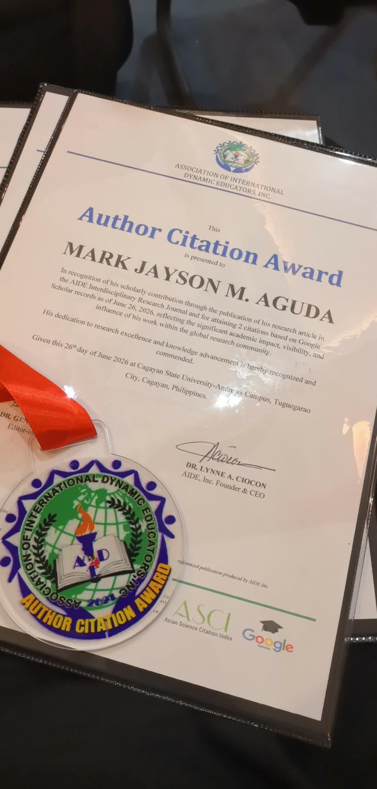

Campus Connect is an Android app that replaces paper logbooks for school employees. Each clock-in can be checked three ways: a **QR code**, a **fingerprint or face scan**, and **GPS** to confirm the person is on campus. I built it and evaluated it with the staff of Flora National High School for my **MS in Information Technology** thesis, which looked at how secure and private attendance apps like this really are.

## What it does

- **Clock in and out** for the morning and afternoon sessions, by entering an ID number or scanning the QR code on the employee's ID card.
- **Biometric check** through Android's biometric prompt (fingerprint or face), to confirm it's really the employee clocking in.
- **GPS geofence:** each school sets its campus boundaries, and a clock-in only counts inside them. Time comes from a time server, not the phone's clock.
- **Daily Time Records:** employees and administrators generate and download DTRs as PDFs, plus each employee's QR code.
- **Time log corrections:** employees report a wrong entry with a reason, and administrators fix it.
- **Per-school settings:** each school turns the QR, biometric, GPS and time-based checks on or off.

## Three roles

- **System administrators** register and manage schools.
- **School administrators** add, edit and transfer employees, generate QR codes and DTRs for all staff, and choose which checks their school uses.
- **Employees** clock in and out, view their attendance, and download their own QR code and DTR.

Data lives in **Firebase Realtime Database**, modelled as schools, employees, feature settings, attendance and time logs.

## The study

- **51 employees** used the app for **three weeks**, with a different combination of checks each week.
- I measured the results with pre- and post-deployment surveys, direct observation, and technical tests such as **penetration testing** and **encryption strength** checks.
- Staff rated it against the **ISO 25010** software quality standard with an overall mean of **4.52 out of 5 (Outstanding)**. Portability scored highest (4.91), followed by usability and maintainability (4.83 each).
- The security review found real weaknesses: logbook access through a known school ID, **GPS spoofing**, and weak encryption. It recommended multi-factor authentication, encryption at rest and in transit, and regular security audits.

## Recognition

- Awarded **Outstanding Thesis** for my MS in Information Technology at Cagayan State University.
- Published in the **AIDE Interdisciplinary Research Journal**: [doi.org/10.56648/aide-irj.v9i1.127](https://doi.org/10.56648/aide-irj.v9i1.127).
- **Author Citation Award** (June 2026) from the Association of International Dynamic Educators, Inc. (AIDE), for the article reaching 2 citations on Google Scholar.

