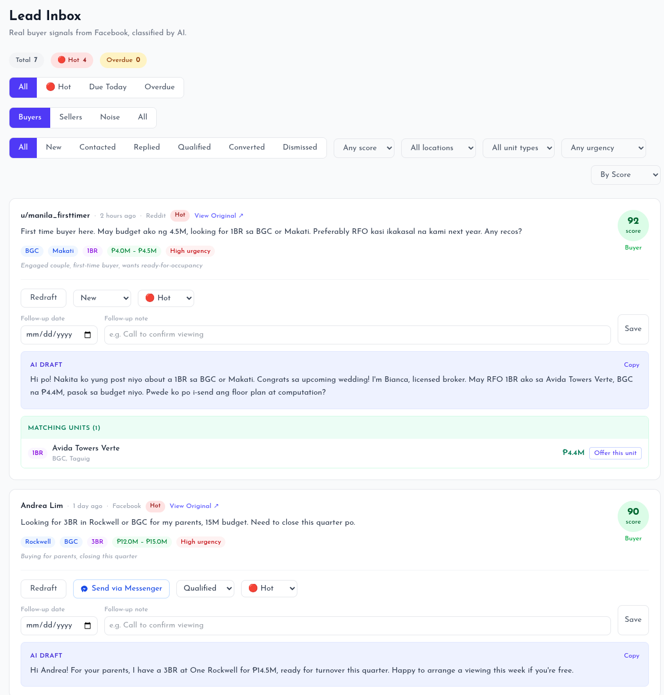
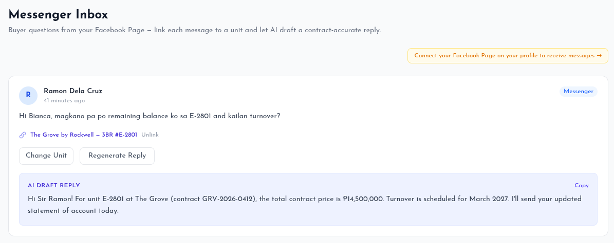
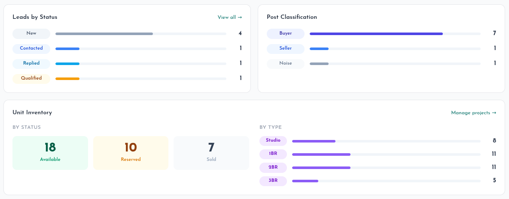

Condo buyers in the Philippines post what they want in the open every day, often in Taglish: *"May budget ako ng 4.5M, looking for 1BR sa BGC or Makati."* Agents miss most of these posts because they're buried in hours of scrolling and noise, and a slow reply loses the sale. CondoLense finds those buyers, ranks them and helps the agent reach out first. I designed and built it end to end.

## Lead finding and scoring

- Pulls posts and comments on a schedule from **property subreddits**, **public Telegram channels** and the agent's own **Facebook Page**.
- An LLM (**LLaMA 3.3 70B on Groq**) classifies each post as buyer, seller or noise, scores buyer intent from 0 to 100, and extracts the **budget, location, unit type and urgency**. Location aliases are normalised on the server too, so "Fort Bonifacio" and "BGC" count as the same place.
- A buyer who posts several times becomes **one lead** with their full message history.
- The lead inbox filters by signal, status, score, location, unit type and urgency.

## AI outreach in the agent's own voice

The agent pastes one message they would normally send, and the AI drafts first-contact messages in the same tone, in **Filipino, Taglish or English**. It also checks the agent's inventory for up to three **available units that match** the buyer's budget, location and unit type, and can write the offer straight into the draft.

## Contract-aware Messenger replies

When a buyer messages the agent's Facebook Page, a **Messenger webhook** matches the sender to their unit (by unit or contract number, owner name or an earlier thread). It then reads the **contract PDF** and drafts a reply from the real figures: total price, amortisation, down payment terms and turnover date. If no unit matches, it asks the buyer for their unit or contract number.

## Inventory and dashboard

- Agents manage their projects and units in the app. Pasting raw unit details or uploading a PDF lets the AI fill in the form, with every AI-filled field highlighted and nothing saved until the agent approves it.
- A dashboard shows the lead pipeline by status, how posts were classified on each platform, and the unit inventory.

## How it's built

- **Laravel 12** with **Livewire 4**, **Alpine.js** and **Tailwind CSS 4**, on **MySQL**. Domain logic lives in single-purpose action classes, and every external API sits behind its own service.
- **Facebook Login**, plus **Reddit OAuth** and the **Telegram Login Widget** for connecting accounts.
- Tests in **PHPUnit**, and a **GitHub Actions** pipeline that runs them, then deploys to **AWS EC2** (Nginx, PHP-FPM).
- Respects the Groq free-tier rate limit (30 requests per minute) by pacing classification calls.
