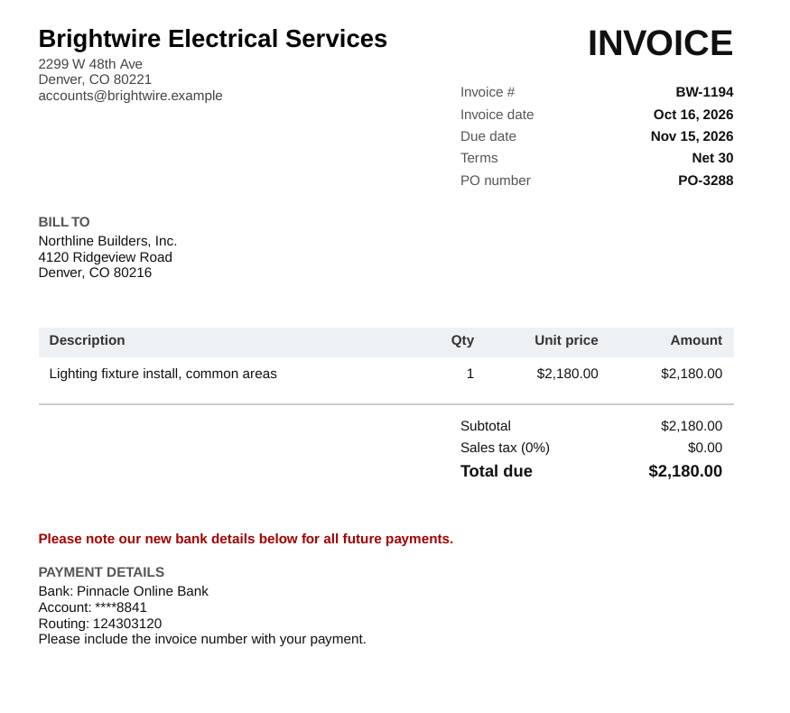
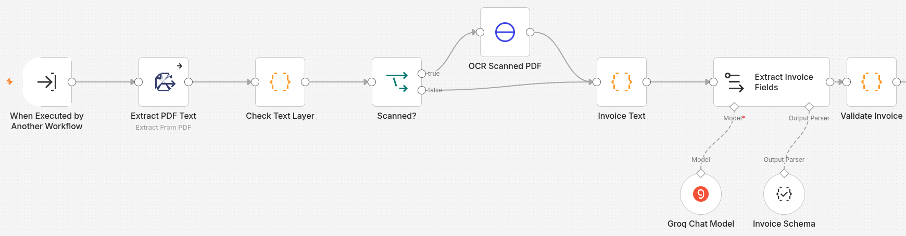
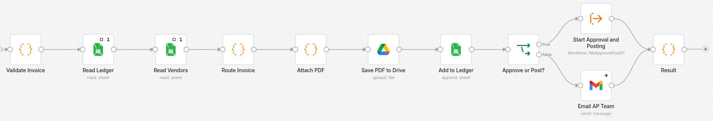
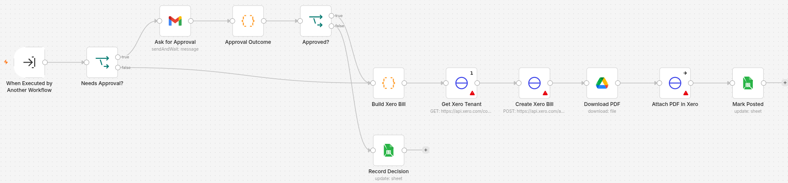

Small businesses still type supplier invoices in by hand. It's slow, typing errors creep in, the same invoice gets paid twice, and "please note our new bank details" emails get paid to fraudsters. I built this **n8n** pipeline as a demo for a general contractor to do accounts payable end to end. I scoped it from a recent Upwork job post: watch an inbox, read scanned PDFs, write the fields to a sheet, hold invoices in an approval queue, and check for duplicates and failures.

## What it does

- Takes invoices from a **Gmail label**, an **upload form** or an **API**. An email with three PDFs becomes three invoices.
- Reads digital PDFs directly. **Scanned** PDFs have no text layer, so they go to a small **Node.js OCR service** (Tesseract) that I wrote.
- **Groq** extracts the vendor, invoice number, dates, PO, line items, totals and bank account as structured JSON.
- **Checks written as code, not prompts:**
  - line items add up to the subtotal, and subtotal plus tax equals the total
  - dates make sense
  - **duplicates** are caught even when the invoice number is typed differently
  - a **possible duplicate** is flagged (same vendor and amount within 30 days)
  - vendors **not on the approved list** are flagged
  - a **changed bank account** is flagged, the classic payment-fraud pattern
  - a **missing PO** is flagged for subcontractors
  - anything over the **$2,500 auto-approval limit** is flagged
- **What happens next:**
  - clean invoices are auto-approved
  - flagged invoices go to an approver as an email with **Approve / Reject** buttons and the reasons
  - duplicates are blocked
  - unreadable invoices go to the AP team
- Approved invoices become **draft bills in Xero** with the PDF attached. Every invoice is logged in a **Google Sheets ledger** and filed in **Drive**.
- Emails the team when any step fails, and sends a **Monday AP summary**: due this week, overdue, waiting for approval, and spend by vendor.

## How it's built

- **Seven n8n workflows:**
  - three intake routes
  - a processing sub-workflow
  - an approve-and-post sub-workflow, which runs on its own so an approval can wait days without blocking intake
  - the weekly summary
  - an error-alert workflow that every other workflow reports to
- The **OCR service** is plain Node.js with no dependencies: `pdftoppm` plus Tesseract in an Alpine image. It reads the scanned demo invoice almost perfectly in about two seconds.
- **30 tests** (`node:test`) run the Code-node JavaScript straight from the exported workflow JSON.
- **One data file** describes the eight demo invoices: clean, scanned, over the limit, maths error, duplicate, new vendor, changed bank details and missing PO. It generates the PDFs, drives the unit tests, and sets what the live **eval script** expects from the running pipeline.
- One `docker compose` stack, and a setup script that imports the credentials and workflows. Everything runs on free tiers.
