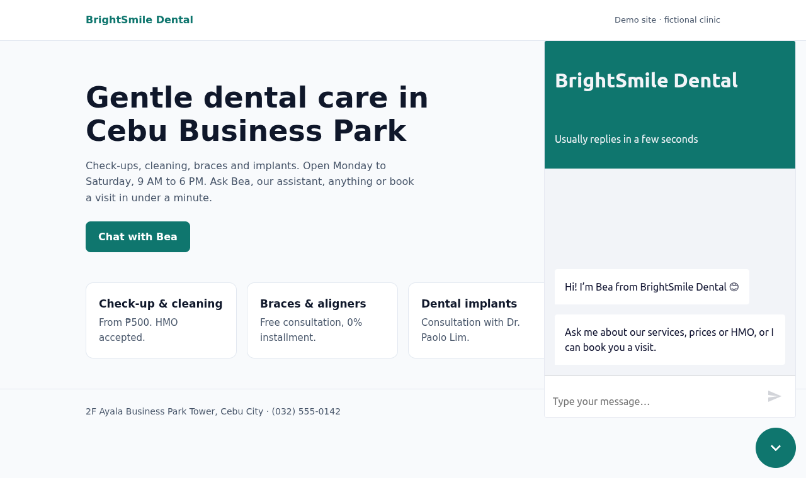
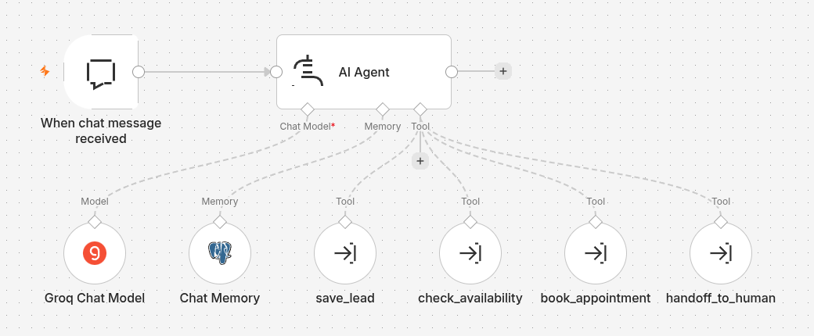
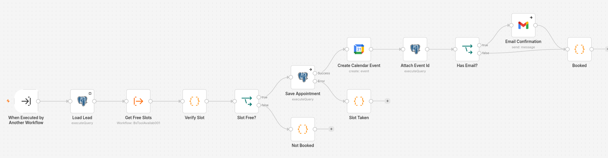
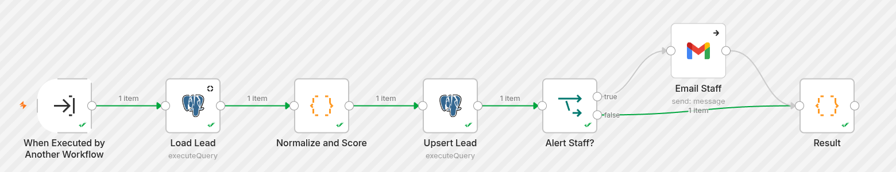

Small businesses lose leads because website enquiries get answered hours later. This is the AI chat assistant I built in **n8n** to fix that, using a fictional dental clinic in Cebu as the client. It works as a 24/7 front desk: it answers questions, qualifies each visitor, books them into the real calendar, and hands the chat to a person when it should. I scoped it from recent Upwork job posts for n8n AI agents, so it covers what clients actually ask for: CRM and calendar tool calls, conversation memory, human handoff and follow-ups.

## What the assistant does

- Answers questions about services, prices, hours and HMO coverage from **one Markdown file** the clinic can edit.
- Collects the visitor's name, contact, service, urgency, preferred time and payment, and saves each detail to the CRM as soon as it's mentioned.
- **Scores each lead from 0 to 100** and tags it hot, warm or cold, plus emergency and new patient. Staff get an email the moment a lead turns hot.
- Offers open slots from **Google Calendar** within opening hours, around the lunch break and for the right service length, then books the slot the patient picks and emails a confirmation.
- Hands off to staff with the **full transcript** when the patient asks for a person, the bot is unsure, or it's an emergency. Real emergencies are sent straight to the ER or 911.
- Follows up on its own: nudges after 24 and 72 hours for leads who didn't book, and a reminder the day before each appointment.
- Replies in English, Filipino, Cebuano or Taglish. It doesn't give medical advice and resists prompt injection.

## How it's built

- The **n8n AI Agent** (Groq, gpt-oss-120b) has Postgres chat memory and **four tools**. Each tool is its own sub-workflow, so the business rules live in JavaScript Code nodes and not in the prompt. The agent decides what to do, and the tools decide whether it's allowed.

- **PostgreSQL** is the CRM: leads, appointments, handoffs and follow-ups, plus SQL views for the funnel (booking rate, handoff rate). A Postgres **exclusion constraint** makes double booking impossible, even if two patients pick the same slot at once.
- **41 unit tests** (`node:test`) run the Code-node JavaScript straight from the exported workflow JSON, so the workflows stay the single source of truth. A Node **eval script** runs scripted conversations against the live agent and checks the results in the database.
- One `docker compose` stack (n8n, Postgres and the demo site) and a setup script that imports the credentials and workflows. It runs on any client server, and everything in it is free to use.
