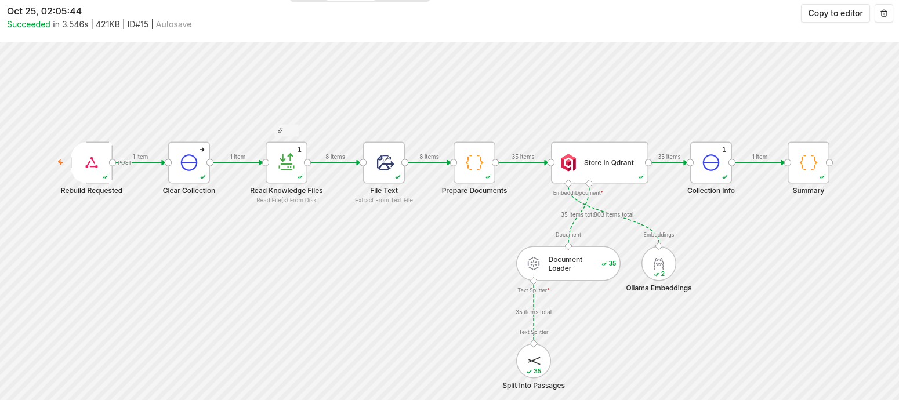

Most store support questions are the same twenty: shipping times, return windows, sizing, "where is my order". Generic chatbots either can't answer them or make answers up, and a customer told the wrong return policy becomes a complaint. I built this **retrieval-augmented (RAG)** support bot in **n8n** for a fictional outdoor-gear store. I scoped it from recent Upwork job posts for n8n agents with a vector-store knowledge base and human handoff.

## What it does

- Answers shipping, returns, sizing, product care, warranty and payment questions **only from the store's help documents**, and names the documents it used.
- **"Where is my order?"** works only when the order number **and** email match. A wrong email gets exactly the same reply as a non-existent order, so nobody can probe other people's orders.
- When the documents don't cover a question, it **opens a support ticket instead of guessing**. It also opens one when the customer asks for a person, reports a damaged package, or asks for an exception the policies don't allow. The customer gets the ticket number.
- Logs every question. A stats endpoint shows the **most common questions the documents don't answer**, so the store knows which help page to write next.
- The knowledge base is rebuilt from Markdown files with one command. An **upload form** adds or replaces a single document (Markdown, text or PDF).

## How it's built

- **n8n AI Agent** on Groq (gpt-oss-120b) with three tools: a **Qdrant** knowledge-base search, `lookup_order` and `create_ticket`.
- **Embeddings run locally** with **Ollama** (`nomic-embed-text`): free, offline, and no data leaves the server.
- A small **Node.js service** with no dependencies stands in for the store's order system and helpdesk: orders with the email check, tickets, the question log and knowledge-gap stats. In a client build, the same HTTP nodes point at Shopify and Zendesk.

## Measured retrieval

I wrote a retrieval eval that needs no LLM: it embeds 16 customer-style questions and checks that the document holding the answer comes back from Qdrant.
- **First version** (~800-character passages): the right document was in the top 3 for 15/16 questions, and ranked first for 12/16.
- **The fix:** split each document at its sections, and start every passage with **"Document title > Section"**.
- **Result:** **16/16** in the top 3, and **16/16 ranked first**.

Other tests:
- **21 unit tests** cover the store API (including the order-privacy rule), section splitting, tool formatting and workflow wiring.
- A chat eval with **8 scripted conversations** checks sources, the order-privacy rule, escalation instead of guessing, and prompt-injection resistance. It runs once a Groq key is connected.
