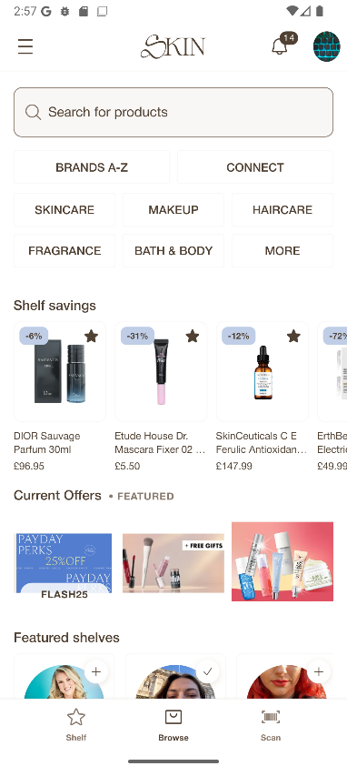

SKIN is a UK app that helps people find the best prices for the beauty products they already use. I built and maintained the **Laravel API** behind its Flutter mobile app.

## Price-drop notifications

I built the notification feature. When any tracked retailer lowers the price of a product on a user's shelf, the user gets an alert, and the deal lands in their in-app notification feed with the retailer, the product and the discount. I also led the integration of the third-party notification, marketing and analytics services (Firebase, Klaviyo, PostHog) that drive engagement and retention.

## AI shopping assistant

I led the **AI-powered in-app assistant** on **AWS Bedrock**. Users chat with it, and it recommends products through conversation. I owned it end to end, from the backend design to the mobile UI.

## Spotlight: sponsored retailer placements

I built the backend for **Spotlight**, which lets the business team run featured retailer placements on the app's Browse screen without an app release.

- **Blocks and tiles:** the team creates named blocks such as "Current Offers", each holding tiles for retailers, with a banner, a destination and an optional **promo code** shown on the tile.
- **Targeting and scheduling:** each block belongs to a **market** and can run on a **date window**, so a campaign starts and ends on its own.
- **Ordering:** blocks and tiles are reordered by drag and drop in the admin panel, and the app shows them in that order.
- **API:** the app asks for the user's market and gets back only the blocks that are live right now, with their tiles in order.

## Also built

- A **multi-provider affiliate product data pipeline** that keeps the catalogue accurate, with fast search powered by **Typesense**.
- Product, social and user features such as shelf sharing, shelf stats and price comparison, plus an **internal admin panel** the business team uses to manage content, analytics and campaigns.
- Infrastructure: **Docker** environment overhauls, framework upgrades and **CI pipeline** improvements.

