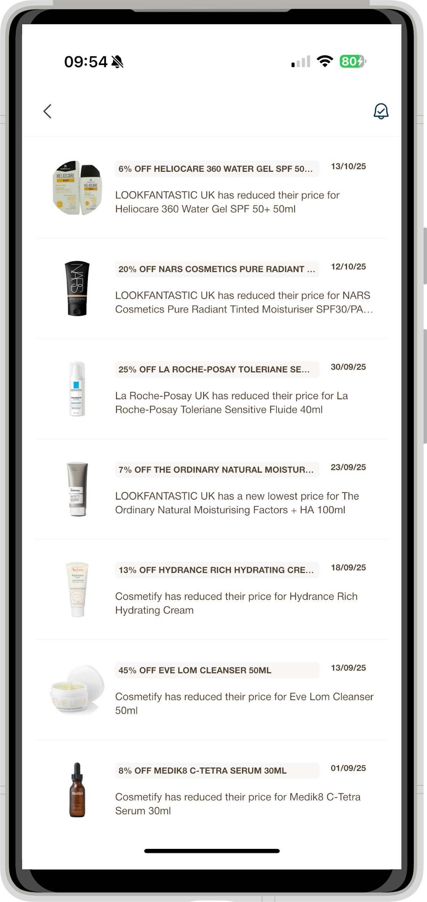
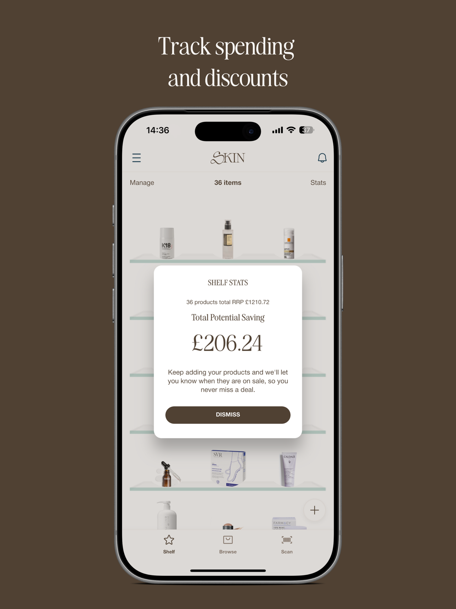
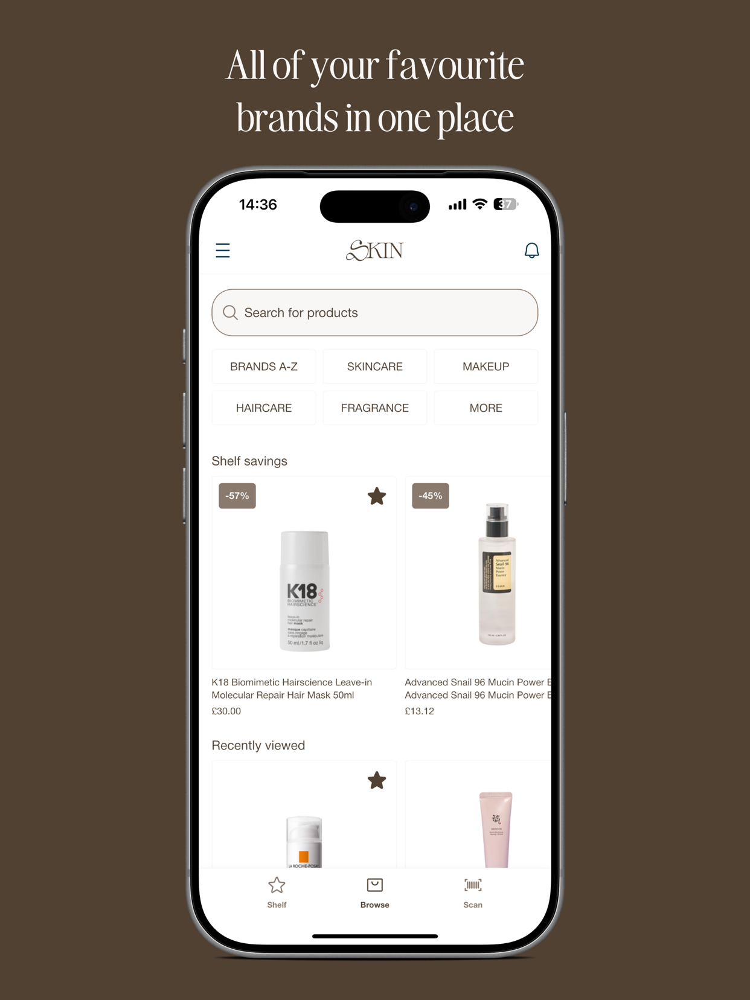
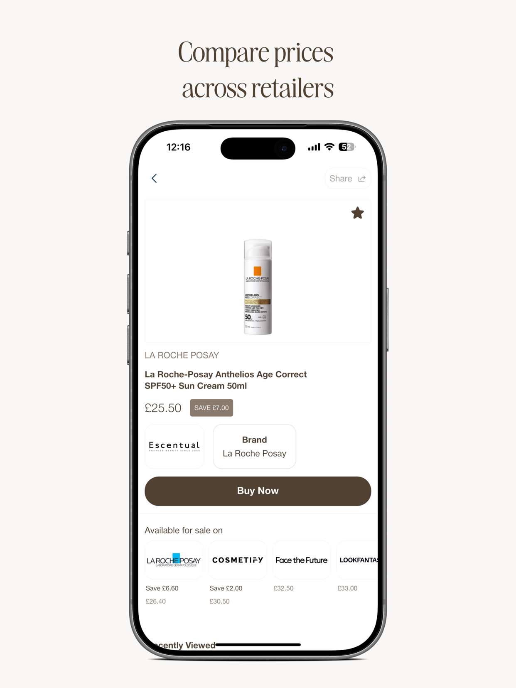

SKIN is a UK app that helps people find the best prices for the beauty products they already use. I built and maintained the **Laravel API** behind its Flutter mobile app.

## Price-drop notifications

I built the notification feature. When any tracked retailer lowers the price of a product on a user's shelf, the user gets an alert, and the deal lands in their in-app notification feed with the retailer, the product and the discount.

## AI shopping assistant

I led the **AI-powered in-app assistant** on **AWS Bedrock**. Users chat with it, and it recommends products through conversation. I owned it end to end, from the backend design to the mobile UI.

## Also built

- Product data pulled from **multiple affiliate retailers**, with fast search powered by **Typesense**.
- User-facing features such as shelf stats and price comparison, plus an **internal admin panel** the business team uses to manage content, analytics and campaigns.

